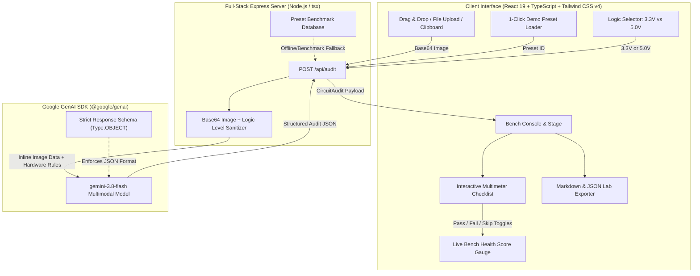

# CircuitLint Vision 🔬⚡

> **Automated Breadboard, Schematic & Bench Verification Linter**  
> Powered by `@google/genai` (`gemini-3.8-flash`) multimodal vision on the server side.

CircuitLint Vision is a clean, dark-mode bench engineering console designed for embedded systems developers, robotics makers, and lab technicians. It audits photos of breadboards, schematic screenshots, and logic analyzer captures to detect fatal electrical hazards (such as 5V-to-3.3V logic level mismatches, missing decoupling capacitors, floating control pins, and unsuppressed inductive spikes) before prototype power-on.

---

## 📐 Data-Flow Architecture

The following Mermaid diagram illustrates how CircuitLint Vision ingests circuit captures, executes server-side Gemini 3.8 Flash multimodal reasoning with rigid JSON schema validation, and yields an interactive multimeter verification checklist:



---

## 🛠️ Tech Stack

- **Frontend**:
  - **React 19** (`react`, `react-dom`) with TypeScript.
  - **Tailwind CSS v4** (`@tailwindcss/vite` & `@custom-variant dark`) for dark-mode styling.
  - **Lucide React** for hardware, instrument, and bus icons.
  - **Motion** for smooth state transitions.
- **Backend**:
  - **Express 4.21** server hosting API endpoints and serving Vite middleware in development.
  - **`@google/genai` (v3.2.0)** SDK initialized exclusively on the server side.
  - **Model**: `gemini-3.8-flash` with `responseMimeType: "application/json"` and `responseSchema`.
  - **`tsx`** for modern TypeScript execution.

---

## ⚡ Core Features

1. **Multimodal Circuit Ingestion**:
   - Upload breadboard wiring photos, schematic captures, or logic analyzer pin connections via drag & drop, file picker, or clipboard paste (`Ctrl+V`).
2. **Voltage Logic Target Selection**:
   - `3.3V Low-Voltage Logic` (ESP32, STM32, RP2040 Pico) — strict 3.6V maximum GPIO input tolerance check.
   - `5.0V Standard TTL/CMOS` (Arduino Uno/Mega, ATmega328P) — check for 3.0V $V_{IH}$ minimum thresholds and 3.3V peripheral overdriving.
3. **Structured Hardware Audit**:
   - **Identified Bill of Materials & Bus Connections**: Microcontrollers, sensors, display ICs, passives, and bus assignments (I2C, SPI, UART, Power, GPIO).
   - **Severity-Ranked Electrical Issues**: Critical, High, Medium, and Low issues detailing fault mechanisms, affected pins, and concrete schematic remediation.
4. **Interactive Multimeter Verification Checklist**:
   - Red probe (+) and Black probe (-) placement instructions.
   - Multimeter modes: DC Voltage ($V_{\tiny\text{DC}}$), Continuity Beeper, Resistance ($\Omega$), Diode Drop ($V$).
   - Expected nominal ranges and danger thresholds.
   - Interactive Pass / Fail / Skip toggles that drive a live **Bench Health Score (0–100%)**.
5. **One-Click Bench Presets**:
   - **ESP32 + 5V I2C LCD & BME280** (Confirmed Default Demo): 5V pull-up backfeed into 3.3V ESP32 GPIOs and missing decoupling capacitor.
   - **Arduino Uno + 3.3V SPI MicroSD**: Direct 5V MOSI driving 3.3V SD silicon without level shifters.
   - **ESP32 + 5V Relay**: Inductive kickback hazard and GPIO overcurrent.

---

## 🚀 Local Setup & Development

### Prerequisites
- Node.js $\ge 20$
- An active Google Gemini API Key

### 1. Clone & Install Dependencies
```bash
git clone <repository-url>
cd circuitlint-vision
npm install
```

### 2. Configure Environment Variables
Copy `.env.example` to `.env` and specify your `GEMINI_API_KEY`:

```bash
cp .env.example .env
```

Edit `.env`:
```env
# GEMINI_API_KEY: Required for Gemini 3.8 Flash multimodal vision calls
GEMINI_API_KEY="your-gemini-api-key-here"

# PORT: Local dev server port
PORT=3000
```

### 3. Run Development Server
```bash
npm run dev
```
Open [http://localhost:3000](http://localhost:3000) in your browser.

### 4. Build for Production
```bash
npm run build
npm start
```

---

## 🔒 Security & Architecture Principles

- **Zero Client-Side Key Exposure**: The Gemini API key is accessed exclusively via `process.env.GEMINI_API_KEY` on the server.
- **Strict Response Schema**: All AI outputs conform to `circuitAuditSchema` via `@google/genai` `Type.OBJECT`, preventing JSON parsing failures.
- **Graceful Bench Fallbacks**: Pre-computed benchmarks guarantee zero downtime during network drops or quota exhaustion.
